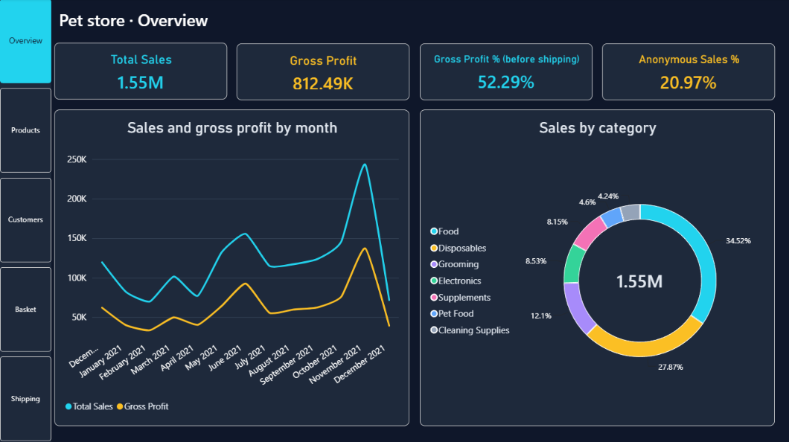
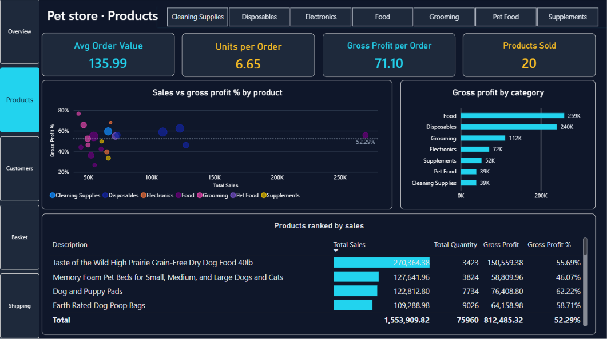
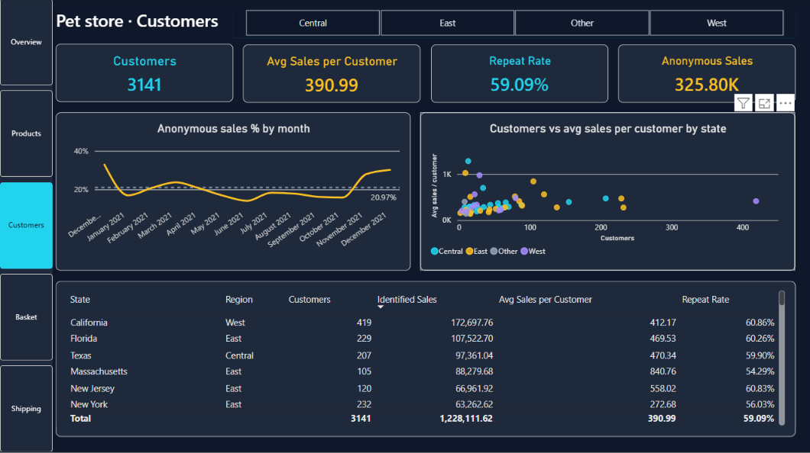
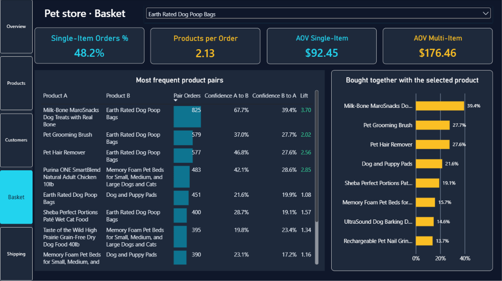
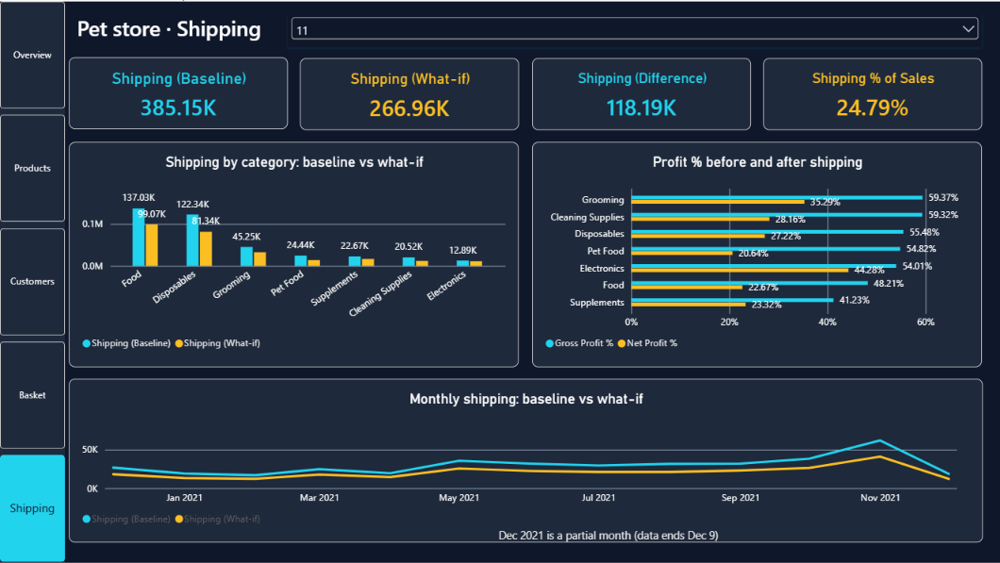

# Pet Store Analytics: Profitability, Customers, Baskets and Shipping

A Power BI project on pet-store sales data (Dec 2020 to Dec 2021). It does not stop at charts: it cleans the raw data, documents every data problem, and answers four business questions with a five-page dashboard.

**Live dashboard:** [Open the interactive report](https://app.powerbi.com/view?r=eyJrIjoiOGZkMmJjNDEtZDAzOC00NjE2LThmZjEtYTJkOTJlZmVmZmQxIiwidCI6IjJiYjZlNWJjLWMxMDktNDdmYi05NDMzLWMxYzZmNGZhMzNmZiIsImMiOjl9) (Power BI, no sign-in required)

## Business questions

1. Which products and categories actually make money once shipping is included?
2. How much revenue can't be tied to a customer, and how do identified customers behave?
3. Which products are bought together, and can they be sold as bundles?
4. How much could the business save if shipments were consolidated?

## Key findings

| Topic | What the data shows |
|---|---|
| Profit | Total sales are **$1.55M**. Gross profit before shipping is **$812.5K (52.3%)**. Shipping costs **$385.1K (24.8% of sales)**, which cuts net profit to **$427.3K (27.5%)**. |
| Categories | Shipping hurts margins unevenly. Pet Food drops from 54.8% to **20.6%** net margin (shipping is 34.2% of its sales). Electronics keeps **44.3%** (shipping is 9.7% of its sales). |
| Anonymous sales | **20.97%** of sales ($325.8K) have no Customer ID, so they can't be linked to a customer or a state. |
| Customers | 3,141 customers made purchases. Average spend is **$390.99** per customer, and **59.1%** bought more than once. |
| Small samples | Some states have very high average spend with very few customers (North Dakota: 13 customers, $1,278 average). These averages are not reliable. |
| Baskets | **48.2%** of invoices contain a single product. Multi-item invoices average **$176.46** against **$92.45** for single-item invoices. |
| Bundles | Dog Poop Bags and Milk-Bone treats appear together in **825 invoices** (lift **3.70**). 67.7% of invoices with the treats also contain the bags. |
| Shipping what-if | Consolidating shipments at a quantity of 11 would cut shipping by **$118.2K (30.7%)**. |

## Dashboard

| Page | Question it answers |
|---|---|
| Overview | Sales and gross profit over time, sales by category, and the share of anonymous sales |
| Products | Which products sell a lot but earn a low margin |
| Customers | Customer value by state, repeat rate, and anonymous sales over time |
| Basket | Which products are bought together (support, confidence, lift) |
| Shipping | Profit before and after shipping, plus a what-if on shipment quantity |







## Data problems found and how they were handled

| Problem | Decision |
|---|---|
| 661 rows with no Invoice No. All have zero or negative quantity (returns, about -$22.9K, roughly 1.5% of sales). | Removed. |
| 4,408 remaining rows with no Customer ID (about 21% of sales). | Kept in sales, profit and basket analysis. Excluded from customer and state metrics. |
| 206 different spellings of US states (case, dots, full names). | Standardized to 51 uppercase 2-letter codes. |
| The state-to-region mapping file contains a wrong row (`Arkansas` mapped to Alaska). | The cleaning script builds its own state lookup and reports the bad row. |
| The same product has two names in sales and in the product table (Stock Codes 22197 and 22502). | Product names always come from the product table, joined by Stock Code. |
| Typo `Cleanig Supplies` in a category name. | Fixed to `Cleaning Supplies`. |
| 90 customers with no latitude or longitude. | Left as is (the dashboard does not use coordinates). |
| The product file is not UTF-8. | Read with `cp1252` encoding. |

The cleaning is done by `scripts/01_clean_data.py`, which also prints a data quality report.

## Data model

Star schema built from four cleaned tables:

```text
Sales[Stock Code]       -> Products[Stock Code]
Sales[Customer ID]      -> Customers[Customer ID]
Customers[Order State]  -> States[State Abbreviations]
```

Two extra tables support specific analyses: `Products B` (a disconnected copy of Products used for basket pairs) and `What-if quantity` (a parameter table for the shipping slider).

Key DAX measures:

- Profit: `Gross Profit`, `Net Profit`, `Net Profit %`
- Customers: `Customers`, `Avg Sales per Customer`, `Repeat Rate`, `Anonymous Sales %`
- Basket: `Pair Orders`, `Confidence A to B`, `Lift`, `Single-Item Orders %`
- Shipping: `Shipping (Baseline)`, `Shipping (What-if)`, `Blended Shipping Cost Factor`

## Limitations

- Shipping is modeled as a per-product rate: full price for the first unit and a reduced rate for each extra unit. It does not use distance or customer location.
- In the what-if, a slider value of 1 or 2 costs more than the baseline, and any value from 10 upward gives the same result. This comes from how the shipping factor tiers are defined.
- December 2021 is a partial month (the data ends on Dec 9), so its drop is not a real decline.
- November 2021 sales are much higher than other months. The data does not explain why, so the dashboard does not assume a cause.
- Returns without an invoice number were removed, so net sales are slightly overstated.
- Basket results describe co-occurrence. They do not prove that a bundle would increase sales.

## Repository structure

```text
pet-store-analytics/
├── README.md
├── data/
│   ├── raw/     original CSV files
│   └── clean/   output of the cleaning script
├── scripts/
│   └── 01_clean_data.py
└── dashboard/
    ├── pet-store-analytics.pbix
    └── screenshots/
```

## How to run

1. Install Python 3.8 or newer and `pandas`:

   ```bash
   pip install pandas
   ```

2. Run the cleaning script from the project root:

   ```bash
   python scripts/01_clean_data.py
   ```

3. Open `dashboard/pet-store-analytics.pbix` in Power BI Desktop. If the data source paths do not match your machine, go to `Transform data` and then `Data source settings`, and point each table to its file in `data/clean/`.

## Tools

Python (pandas), Power BI (Power Query, DAX, data modeling, what-if parameters).

## Author

Adham Refaat Soliman

- Portfolio: https://adhamkhafagy.lovable.app
- GitHub: https://github.com/adhamkhafagy
